<!-- _class: lead -->
<!-- _paginate: false -->

# CLIMP: Contrastive Language-Image Mamba Pretraining

### A reproduction and critical study

Shabtay, Zimerman, Schwartz, Giryes — arXiv 2601.06891 (2026)

 

**Tanish Wanve** · CS613 paper presentation
Code, results and every number on these slides: github.com/tanishwanve-git/climp-cs613

<!--
(~20 s) Today I'll teach a 2026 paper that rebuilds CLIP entirely out of state-space models — Mamba — instead of Transformers.
I'll explain the problem, the idea, how it works, and then what happened when I re-ran the authors' released models on 8 experiments,
including 4 analyses that are not in the paper. Every number on the slides comes from my own result files.
-->

---

<!-- header: A · Problem & motivation -->

## The problem: CLIP's Transformer towers have three bottlenecks

CLIP learns one embedding space for images and text from (image, caption) pairs. It is the backbone of zero-shot classification, image–text retrieval, and the vision side of most multimodal LLMs.

| Bottleneck | Concretely | Consequence |
|---|---|---|
| **Quadratic attention** in the ViT image tower | 224 px → 14×14 = 196 patches; 896 px → 56×56 = **3,136 patches**. 16× more pixels ⇒ **256× more** attention entries | High resolution is expensive; the learned position grid only fits one size |
| **77-token text limit** | Dense captions are long: DOCCI averages **~142 tokens, 94% exceed 77** | Everything after token 77 is silently cut off |
| **Spurious correlations** | Pairwise attention can latch onto non-robust cues | Fragile under distribution shift |

<b>Why it matters:</b> CLIP is infrastructure. Any weakness in its encoders propagates into every retrieval system and vision-language model built on top of it.

<!--
(~60 s) Start with what CLIP is: two encoders trained so that an image and its caption land close together.
The paper names three weaknesses of the Transformer design. First, cost: a ViT cuts the image into 16-pixel patches and every patch attends to every other.
Going from 224 to 896 pixels is 16x more pixels but 256x more attention pairs — quadratic. ViTs also learn a position embedding for one grid size.
Second, CLIP's text encoder has 77 learned positions. Modern dense captions are about 142 tokens, so CLIP literally never reads most of them.
Third, attention can rely on spurious cues, which hurts robustness. These matter because CLIP is used everywhere.
-->

---

## What existing work fixed — and what it left open

| Line of work | What it fixes | What remains |
|---|---|---|
| **FlexViT, NaFlex, RoPE-ViT** | ViT at variable resolution | Still O(L²); needs special position schemes or extra training |
| **LLM2CLIP, UniViTAR** — an LLM as the text tower | Long, rich text | Vision tower is still a Transformer |
| **CLIP-Mamba** (Huang et al. 2024) | First Mamba inside CLIP | Hybrid towers only; narrow evaluation |
| **Vim, VMamba** — vision SSMs | Linear-time vision, spatial inductive bias | Never tested as a full CLIP backbone |

### What motivated the authors

State-space models (Mamba) process sequences in **linear time**, have **no position table**, and carry a **locality bias**. Each of these properties addresses one of the three bottlenecks.

<b>Hypothesis:</b> make <i>both</i> CLIP towers SSMs, and the model inherits all three benefits at once.

<!--
(~45 s) People have attacked each bottleneck separately. FlexViT/NaFlex/RoPE make ViTs resolution-flexible but keep the quadratic cost.
LLM2CLIP uses a big language model as the text tower — long text, but the vision side is still a ViT. CLIP-Mamba tried Mamba inside CLIP but only as hybrids.
The authors' observation: Mamba is linear-time, has no position table, and is biased towards locality — one property per bottleneck. So: go fully SSM on both sides.
-->

---

<!-- header: B · Key contribution -->

## The core idea: CLIP built entirely from state-space models

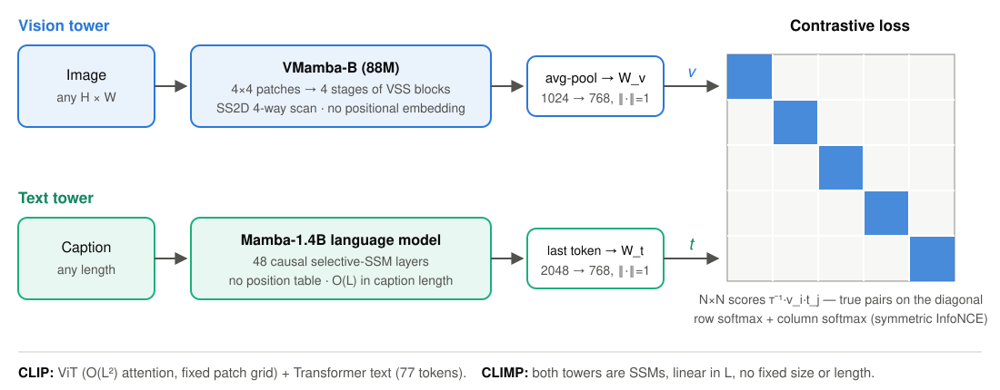

**What is new:** (1) the first CLIP with an SSM in **both** towers · (2) a **controlled** comparison: every model trained on the same data (CC12M) with the same recipe · (3) a broad evaluation: retrieval, OOD, resolution, long text, geometry, efficiency, inductive bias.

<!--
(~60 s) Here is the whole model. Top: the image goes into VMamba-B, an SSM vision backbone with a 2-D scan and NO positional embedding, then a projection to 768 dimensions.
Bottom: the caption goes into a pretrained 1.4-billion-parameter Mamba language model; we take the hidden state of the last real token and project it.
Right: the standard CLIP contrastive loss — in a batch of N pairs, the N matching pairs (the diagonal) should score higher than all N²−N mismatches.
What's novel is not a new loss or a new block; it's the first fully-SSM CLIP, trained in a controlled way so that differences come from the architecture, not the data.
-->

---

## The key insight — and why it should work

> **In an SSM, the scan order *is* the positional encoding.** Nothing in the model depends on how long the sequence is.

| Claim | Mechanism | Paper's evidence |
|---|---|---|
| **Any resolution**, no retraining | No position table; the same weights scan a 14×14 or a 56×56 patch grid | Table 4: retrieval at 224 / 512 / 896 px |
| **Any caption length** | Causal LM with no position table; the last token has read everything | Tables 5–6: long-caption retrieval |
| **Robustness, better retrieval** | The recurrence decays with distance (Mamba-2: state from *k* steps back weighted by λᵏ) → locality bias; tighter alignment, lower hubness | Tables 2, 7, 8 |
| **Efficiency** | Linear-time scan instead of quadratic attention | Fig. 3: memory and FLOPs |

These four claims are exactly what my experiments test, using the released checkpoints.

<!--
(~50 s) The central insight in one sentence: in a Transformer, position must be injected through an embedding table of fixed size; in an SSM, position is implicit in the order the sequence is scanned.
That single property gives "any resolution" on the vision side and "any length" on the text side.
The authors also argue the recurrence has a locality bias — for Mamba-2 the transition is a scalar times identity, so information from k steps back decays like lambda to the k — and that this bias gives robustness and a better-shaped embedding space.
Each row of this table is a claim I tested.
-->

---

<!-- header: C · Method -->

## How Mamba works: a learned, selective recurrence

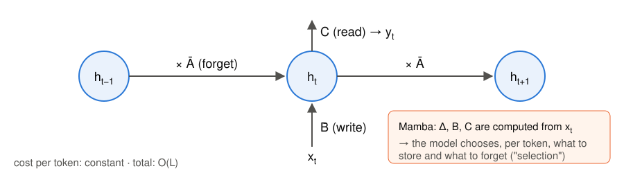

**Continuous SSM**
$$h'(t) = A\,h(t) + B\,x(t),\qquad y(t) = C\,h(t)$$
**Discretised with step Δ** (zero-order hold)
$$\bar A = e^{\Delta A},\quad \bar B \approx \Delta B,\quad h_t = \bar A\,h_{t-1} + \bar B\,x_t$$

Large Δ: reset and focus on this token. Small Δ: keep the past, mostly ignore this token.

| | Mamba-1 | Mamba-2 |
|---|---|---|
| Δ, B, C | depend on xₜ (**selection**) | depend on xₜ |
| A | per channel | scalar · I (SSD) |
| Speed | linear scan | **2–8× faster** |
| CLIMP NoCaps R@1 (ours) | **38.2** | 37.4 |

<!--
(~70 s) An SSM keeps a hidden state h — a running summary. Each step it decays the old summary by A-bar ("forget"), writes the new token through B-bar, and reads out through C.
The step size Delta controls the trade-off: big Delta means "this token matters, overwrite"; small means "ignore it, keep memory".
Mamba's key idea is selection: Delta, B and C are computed from the current token, so the model decides per token what to remember — that is what lets it compete with attention on language.
Cost per token is constant, so a whole sequence is linear in length.
Mamba-2 restricts A to a scalar times identity, which turns the recurrence into matrix multiplications — 2 to 8x faster — but less expressive. The paper finds Mamba-1 slightly better for CLIP, and my NoCaps numbers agree: 38.2 vs 37.4 R@1.
-->

---

## Vision tower: VMamba's 2-D selective scan (SS2D)

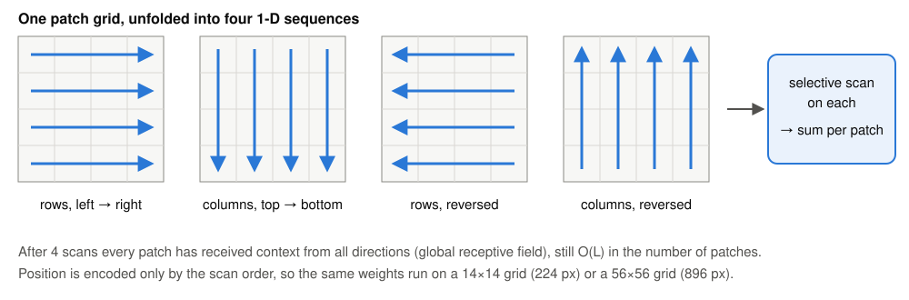

- An image is not a sequence, so VMamba **unfolds the patch grid four ways**, scans each, and sums the results per patch
- Hierarchical: 4 stages with patch merging (like a CNN), then average-pool → W_v
- CLIMP sets **`posembed=False`**, so position comes only from the scan order

**I checked this in the code.** VMamba-B has identical parameter names and shapes when built for 224 px and for 896 px. **One set of weights serves every resolution**: no interpolation, no retraining.
(assertion in exp_nocaps.py; logged in E1.log)

<!--
(~50 s) A 1-D scan of an image would make vertically adjacent patches far apart. VMamba's fix: unfold the grid four ways — rows, columns, and both reversed — run a selective scan on each, and add the four outputs at every patch.
After that, every patch has information from all directions, so the receptive field is global, but the cost is still linear.
Crucially CLIMP turns positional embeddings off. I verified in the code that the model built for 224 and for 896 has exactly the same parameters — so "any resolution" is literally true: you just feed a bigger grid.
-->

---

## Text tower and training objective

### Last-token pooling

$$t_{\text{raw}} = H_k,\qquad k = \max\{\, i : \text{token } i \text{ is not padding}\,\}$$

- Mamba is **causal**: hₜ only sees tokens ≤ t, so the **last real token is the only one that has read the whole caption**. This is the same reason GPT-style embedders use the last token.
- With no position table, captions of **any length** are accepted
- Check: right padding (Mamba-1) and left padding (Mamba-2) give identical embeddings: cosine **1.00000**

### Symmetric InfoNCE (CLIP's loss)

$$\mathcal L = -\frac{1}{2N}\sum_{i=1}^{N}\Big[\log \frac{e^{v_i\cdot t_i/\tau}}{\sum_j e^{v_i\cdot t_j/\tau}} + \log \frac{e^{t_i\cdot v_i/\tau}}{\sum_j e^{t_i\cdot v_j/\tau}}\Big]$$

- In words: in each **row and column** of the N×N similarity matrix, the true pair must win a softmax
- The other N−1 captions in the batch act as **negatives**, so CLIP needs big batches (paper: 2048)
- τ is learned (initial value 0.07); embeddings are unit-length, so v·t is a cosine

<!--
(~70 s) Left: how a sentence becomes one vector. Mamba is causal — every hidden state only depends on earlier tokens — so the only position that has seen the entire caption is the last real token. CLIMP takes that hidden state.
A practical detail I verified: the Mamba-1 tokenizer pads on the right and Mamba-2 on the left; with last-real-token pooling both give exactly the same embedding, cosine 1.00000.
Right: the loss. Picture the N-by-N matrix of cosine similarities in a batch. Each image must pick its own caption out of N candidates — a softmax over the row — and each caption must pick its image — the column. Averaging both directions makes it symmetric.
The other captions in the batch are the negatives, which is why batch size matters. Tau, the temperature, is learned and sharpens the softmax.
-->

---

## Training procedure and design decisions (paper)

**Recipe** (identical for all models)
- CC12M, 10 epochs, 224 px
- AdamW, cosine, peak LR 5e-5
- Batch 2048, 768-d joint space
- Init: VMamba-B ← ImageNet-1K; text ← pretrained Mamba-1 1.4B / Mamba-2 1.3B
- Baselines: RoPE-ViT / FlexViT / NaFlex + **LLaMA-3.2-1B** text tower, same recipe

**Design decisions**

| Decision | Why |
|---|---|
| SSM on **both** sides | Linear cost and no fixed size on either modality |
| Causal pretrained LM, not a bidirectional SSM | Mature checkpoints exist; Hydra (bidirectional) was worse |
| No positional embedding | Any-resolution inference for free |

**Ablation (Table 10)**, Acc@1 on 28 datasets: VMamba + Mamba-1 **29.6** vs VMamba + LLaMA **26.1**. RoPE-ViT barely changes with the text tower (27.3 → 28.1). The authors' reading: **matched SSM towers learn more compatible representations**.

<!--
(~60 s) The paper's protocol is a controlled comparison: CLIMP and three Transformer baselines are all trained on CC12M, 10 epochs, batch 2048, same optimiser. Vision towers start from ImageNet; text towers from pretrained LMs.
Design choices: SSMs on both sides for linear cost; a causal pretrained LM because good bidirectional SSMs don't exist yet — they tried Hydra and it was worse; no positional embedding for resolution freedom.
The most interesting ablation: swapping the text tower barely matters for RoPE-ViT, but VMamba gains 3.5 points with a Mamba text tower instead of LLaMA — the authors call this architectural synergy. All numbers on this slide are the paper's.
-->

---

<!-- header: D · Experiments & results -->

## My study: setup

| ID | Experiment | Data | Paper |
|---|---|---|---|
| E1 | NoCaps retrieval @224/512/896 | 4,500 img · 45,000 captions | Table 4 |
| E2 | Alignment · uniformity · hubness | NoCaps @224 | Table 8 |
| E3 | Zero-shot ImageNet-V2/R/A/O | 10k / 30k / 7.5k / 2k | Table 2 |
| E5 | DOCCI long captions @896 | 5,000 pairs | Table 6 |
| E6 | Memory + FLOPs vs resolution | — | Fig. 3 |
| E8 | Tiny VMamba vs ViT, CIFAR-10, 3 seeds | 50k / 10k | Table 7 |
| NEW | CSLS · text truncation · patch shuffle · SugarCrepe | | — |

- **Models:** the authors' **released** CLIMP-Mamba1 / Mamba2 checkpoints
- **Baseline: OpenCLIP ViT-B/16 (LAION-2B)**. The paper's baselines are unreleased; same size (86 M vs 88 M); the paper itself cites it. ⚠ **~167× more data**, so *not* controlled
- **Metrics:** R@k, top-1/5, alignment / uniformity / hubness
- **Compute:** Kaggle 2× T4, fp16 (as upstream)
- **Correctness gate:** E1 must match the README within ±0.5 pp first

<!--
(~60 s) What I actually did. I took the authors' released checkpoints and re-ran six of their experiments, plus four new analyses.
For a baseline I used OpenCLIP ViT-B/16 trained on LAION-2B: the paper's Transformer baselines were never released; this one has the same vision-tower size; and the paper itself compares against it on ImageNet-O.
But I want to be upfront: it saw about 167 times more data than CC12M, so it tells us how CLIMP compares to a CLIP people actually use, not whether the architecture is better at equal data.
Everything ran on two free Kaggle T4 GPUs. A correctness gate checks my pipeline against the README numbers before any other experiment is trusted.
-->

---

## Reproduction at a glance: the released models behave exactly as reported

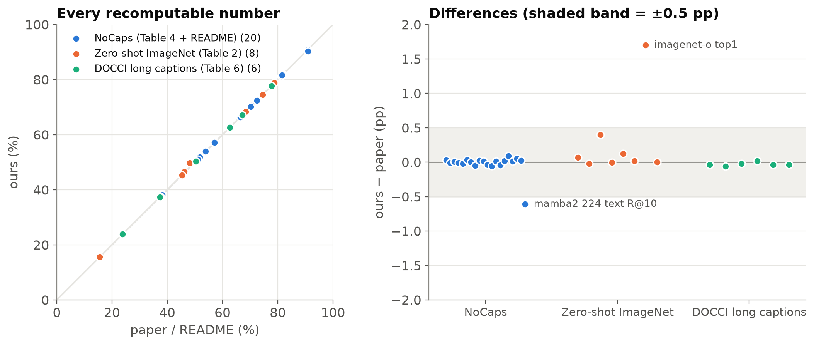

<b>32 of 34</b> recomputable numbers match within ±0.5 pp (median gap <b>0.02 pp</b>). Outliers: ImageNet-O top-1 (+1.7) and Mamba-2 text R@10 (−0.6). These are the authors' trained weights, so a match validates my <i>evaluation</i>; I retrain CLIMP myself later (slides 19–20).

<!--
(~45 s) Before interpreting anything, is my evaluation correct? Left: each dot is one number from the paper's tables or README, plotted against my measurement — all on the diagonal. Right: the differences. 32 of 34 are inside half a point; the median difference is two hundredths of a point.
The two outliers: ImageNet-O top-1 is 1.7 points higher than reported, and Mamba-2's text R@10 is 0.6 lower — the README lists 90.9 for both models in that cell, possibly a copy error.
Important honesty point: these are the authors' trained weights, so exact agreement shows my evaluation pipeline is right; it doesn't re-verify their training.
-->

---

## Resolution scaling (E1, Table 4): reproduced, but the comparison matters

REPRODUCED Every cell of Table 4 matches. Against the paper's RoPE-ViT, CLIMP degrades far more gracefully at 896 px (57.1 vs 38.6 image R@5).

NEW A public ViT with plain interpolated positions stays ahead at every resolution. It loses image R@5 at the same rate (−20% vs −19%), while CLIMP's text R@5 drops more (−35% vs −19%).

<!--
(~60 s) All models were trained at 224 and evaluated up to 896 with no fine-tuning. Grey dashed: the paper's own RoPE-ViT baseline, which collapses at 896 — that's the paper's story, and the CLIMP lines reproduce their table exactly.
Orange is the off-the-shelf OpenCLIP ViT, which just interpolates its position embeddings. It's higher everywhere and degrades at about the same relative rate on image retrieval; on text retrieval CLIMP actually drops faster.
So "any resolution without position embeddings" is real — the model runs and the numbers are as reported — but it does not make CLIMP better at high resolution than a strong ViT. Some of the paper's gap may come from a weak baseline.
-->

---

## Zero-shot robustness (E3, Table 2)

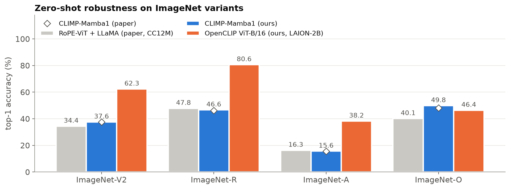

REPRODUCED Top-5 matches exactly; top-1 within 0.4 pp (ImageNet-O +1.7). Against the paper's CC12M baseline, CLIMP wins on V2 and O.

The headline <b>"beats CLIP trained on 167× more data"</b> holds on <b>ImageNet-O only</b> (49.8 vs 46.4). On V2, R and A, OpenCLIP leads by 23–34 pp.

<!--
(~55 s) Grey: the paper's best Transformer baseline trained on the same CC12M. Blue: CLIMP as I measured it; the diamonds are the paper's values — they sit on top of my bars.
The controlled claim holds: at equal data CLIMP beats RoPE-ViT on V2 and especially ImageNet-O.
The abstract's bigger claim — that CLIMP beats CLIP trained on 167x more data — I can confirm only on ImageNet-O: 49.8 versus 46.4. ImageNet-O is unusual: it's built from out-of-class images that fool ResNets, designed for OOD detection. On V2, R and A, the data-rich model is far ahead. So that headline rests on one dataset.
-->

---

## Embedding geometry (E2, Table 8) and a free fix for hubness

| NoCaps @224 | Align ↓ | Unif. img ↓ | Unif. txt ↓ | Hub. img ↓ | Hub. txt ↓ |
|---|---|---|---|---|---|
| CLIMP (paper) | 0.982 | −3.18 | −3.54 | 1.01 | 1.15 |
| **CLIMP (ours)** | **0.982** | **−3.184** | **−3.546** | 1.55 | 1.79 |
| OpenCLIP (ours) | 1.437 | −2.724 | −2.736 | 1.68 | 4.12 |

- REPRODUCED Alignment and uniformity match exactly. Hubness is higher; the paper never states its *k* (we use *k* = 10)
- CLIMP has **far better geometry** than OpenCLIP… yet **worse retrieval**. Geometry alone does not explain accuracy

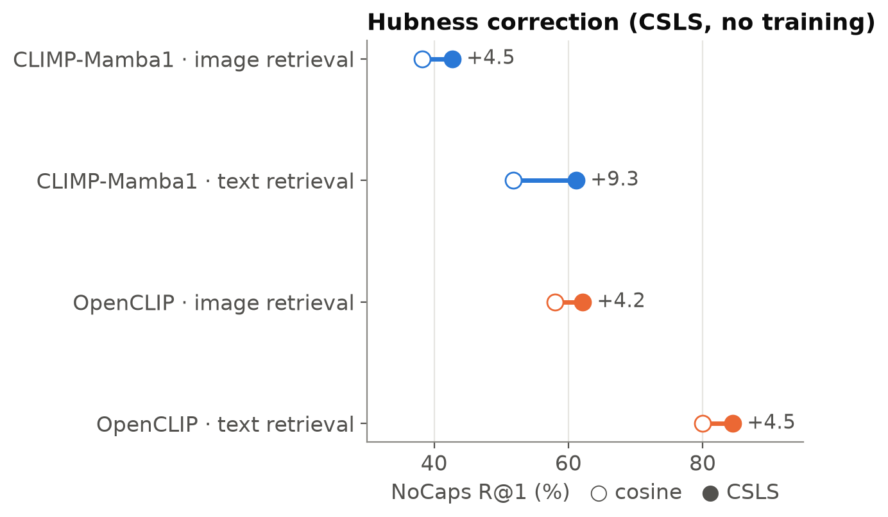

NEW **CSLS** penalises "hub" items, which sit near everything. It needs no training and gives CLIMP **+9.3 pp** text R@1, twice OpenCLIP's gain. Transductive: uses the test set's own neighbourhoods.

<!--
(~60 s) Alignment: how close matched image-text pairs are. Uniformity: how evenly embeddings spread over the sphere. Hubness: whether a few items show up in everyone's nearest-neighbour list.
My alignment and uniformity match the paper to every printed digit. Hubness is higher, but the paper doesn't say which k it used, so absolute values aren't comparable.
The interesting part: CLIMP's geometry is much better than OpenCLIP's — yet OpenCLIP retrieves much better. So the paper's causal story "better geometry, therefore better retrieval" is incomplete.
New: CSLS rescores similarities by subtracting each item's average similarity to its neighbours, which punishes hubs. With zero training it adds 9.3 points of text R@1 to CLIMP — so CLIMP's remaining hubness still costs real accuracy.
-->

---

## Efficiency (E6, Fig. 3): FLOPs reproduce, the memory claim does not

REPRODUCED FLOPs within 5% of the paper; VMamba needs <b>1.83× fewer</b> FLOPs at 896 px (paper: 1.8×). Quadratic attention shows up in ViT's curve.

NEW Memory depends on the attention kernel: VMamba uses <b>7.8× more</b> than a ViT with modern fused attention (573 vs 74 MB). It is lower only than "eager" attention, above ~768 px. The paper's 10 MB is never defined.

<!--
(~60 s) Right panel: compute. My FLOP counts are within 5% of the paper's, and VMamba needs 1.83x fewer at 896 — exactly their 1.8x. The quadratic term makes ViT's curve bend upwards.
Left panel: activation memory for one image. The paper says CLIMP uses 5x less memory — 10 MB vs 50. I couldn't reproduce that. Against today's default ViT with fused, memory-efficient attention, VMamba uses 7.8x MORE. Only against old-style "eager" attention, which stores the full 3,000-by-3,000 attention matrix, does VMamba win, and only above about 768 pixels.
VMamba's memory is high likely because SS2D keeps four directional copies of every feature map. Fused attention removes the quadratic memory, though not the quadratic compute.
-->

---

## Spatial inductive bias (E8, Table 7) — and does it transfer?

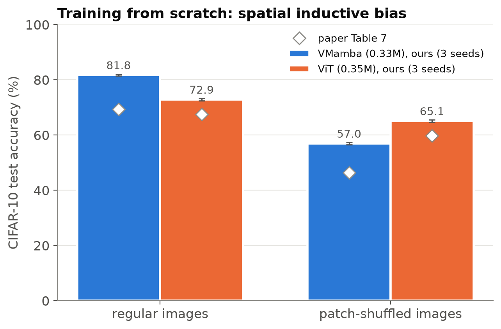

REPRODUCED Tiny models trained from scratch: **VMamba wins on normal images (+8.9 pp) and loses most when shuffled** (−24.8 vs −7.8 pp). Same pattern as the paper; higher absolute accuracy (the paper's recipe is unstated).

NEW On the **pretrained** CLIMP, shuffling blocks gives the **same relative drop** as the ViT at every grid size (−31% vs −30% at 4×4).

The scan-order bias is real when data is scarce, but at pretraining scale <b>it does not make CLIMP more layout-sensitive than a ViT</b>, so it cannot explain the robustness claims by itself.

<!--
(~70 s) Left: the paper's cleanest experiment, which I retrained with 3 seeds. Tiny VMamba and ViT on CIFAR-10. On normal images VMamba wins by about 9 points; when you shuffle the 4x4 patches it loses 25 points while ViT loses 8. So VMamba really does rely on spatial layout — the scan order encodes adjacency. The paper's pattern reproduces exactly; my absolute accuracies are higher because the paper doesn't give its training recipe.
Right, new: does that bias survive in the big pretrained model? I shuffled ImageNet-V2 images into G-by-G blocks and measured zero-shot accuracy. Relative to unshuffled, CLIMP and OpenCLIP drop by the same amount at every grid size.
So the inductive bias matters for small-data learning, but you can't extrapolate it to the pretrained model's robustness without a test like this.
-->

---

## Long captions (E5, Table 6): reading more text helps — up to a point

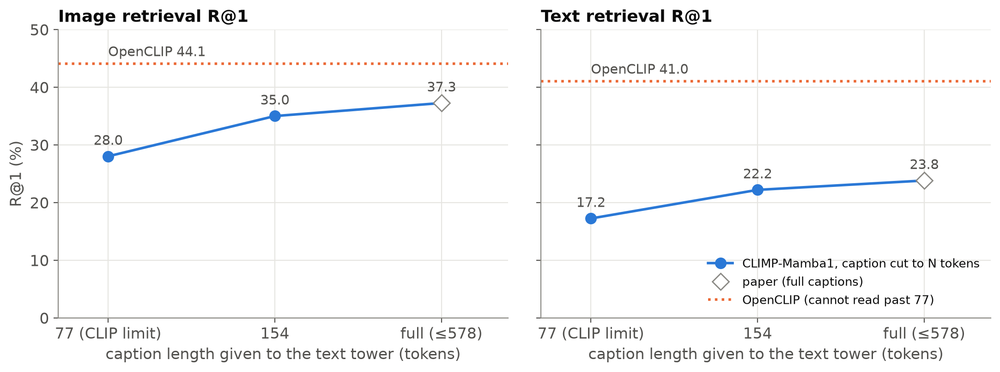

REPRODUCED Full-caption DOCCI retrieval matches Table 6 (37.3 / 23.8 R@1). NEW Cutting captions to CLIP's 77 tokens costs CLIMP <b>9.2 pp</b> image R@1; <b>~75% of the gain arrives by 154 tokens</b>.

But OpenCLIP, which reads <b>less than half</b> of each caption, still wins on every metric (44.1 vs 37.3 image R@1, 41.0 vs 23.8 text R@1). Long context does not overcome a weaker base model.

<!--
(~55 s) DOCCI captions average 143 tokens; 94.5 percent are longer than 77 — I measured the same statistics as the paper.
The paper only reports full-length captions, so it never isolates the effect of length. I fed CLIMP the same captions cut to 77 tokens, 154, and full. Going from 77 to full adds 9.2 points of image R@1 — direct evidence that the long-text ability is real and useful; three-quarters of the benefit is already there at 154 tokens.
But the dotted orange line is OpenCLIP, which can only ever read 77 tokens, and it still beats CLIMP. Reading more text helps, but it doesn't make up for a weaker base model.
-->

---

## Compositional understanding NEW (SugarCrepe, 7,511 items)

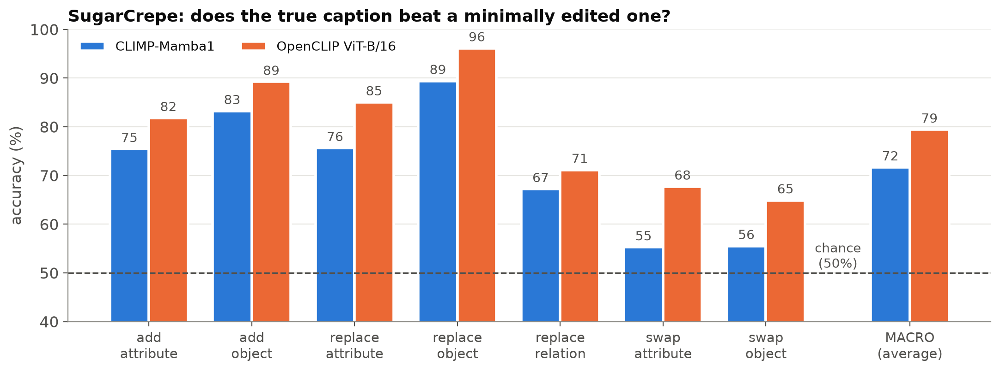

CLIMP trails OpenCLIP on every subset (macro <b>71.7 vs 79.4</b>), and is <b>near chance on "swap"</b>: "a white dog and a black cat" vs "a black dog and a white cat".

Surprising, because the text tower is a 1.4B <b>causal</b> LM that is sensitive to word order. The contrastive objective never forces it to use that, so CLIMP inherits CLIP's <b>"bag of words"</b> behaviour.

<!--
(~45 s) SugarCrepe takes a COCO image with its true caption and a minimally edited one — an object added, replaced, or two words swapped — and asks whether the model prefers the true caption. Chance is 50 percent.
CLIMP is below OpenCLIP everywhere, and on swaps it's barely above a coin flip. That's surprising, because its text tower is a large language model that should care about word order.
But the contrastive loss on web captions rarely needs word order to find the right image, so the model doesn't learn to use it — the well-known bag-of-words behaviour of CLIP models. Hard negatives during training would be the fix.
-->

---

## Retraining CLIMP ourselves, without the released weights NEW

**Why:** matching the released checkpoints validates the *evaluation*. Does the *recipe* work when we train it?

| | Paper | Ours |
|---|---|---|
| Vision init | VMamba-B ImageNet-1K | **same** (official ckpt) |
| Text tower | Mamba-1.4B, **trained** | Mamba-1.4B, **frozen** |
| Loss / optimiser | InfoNCE, AdamW 5e-5 cosine | **same** |
| Data | CC12M (12M) | **COCO (118k)**, 4 epochs |
| Batch | 2048 | 96 (2× T4, 4.7 h) |

The frozen text tower is a forced deviation: 1.4B parameters don't fit on a T4 for training. I verified that the authors **did** train theirs (all 482 tensors differ from pretrained Mamba).

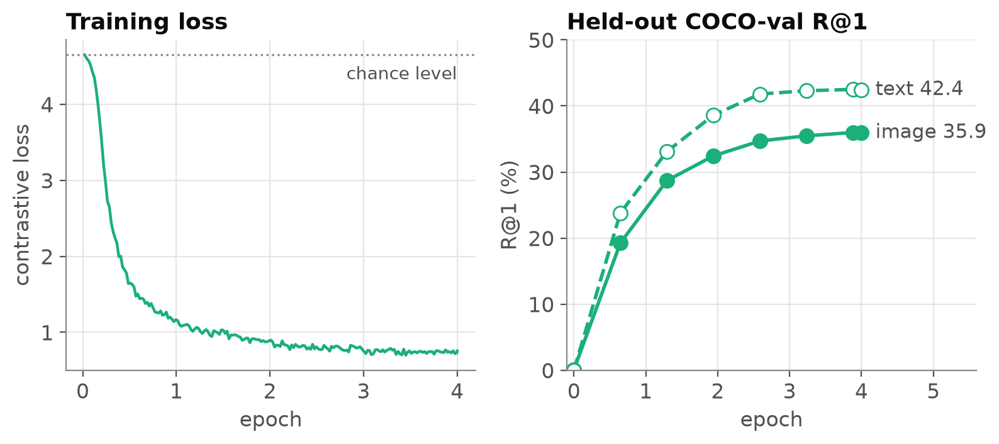

Training works: from chance to <b>36 / 42</b> R@1 on held-out COCO. Gains flatten after ~2.5 epochs.

<!--
(~50 s) The reproduction so far used the authors' trained weights — so it checks evaluation, not training. So I retrained CLIMP myself from the same starting points: ImageNet VMamba-B and pretrained Mamba-1.4B, with the paper's loss and optimiser.
Two big compromises: data — COCO, 118 thousand images instead of 12 million — and the text tower is frozen, because a 1.4B model can't be trained on a 16 GB T4. I checked the released weights: the authors did train their text tower, so this is a real deviation.
Right: 4 epochs, 4.7 hours on two T4s. Loss falls from chance, and held-out COCO retrieval climbs to 36 and 42 percent R@1, then flattens.
-->

---

## Retrained CLIMP: what survives at small scale NEW

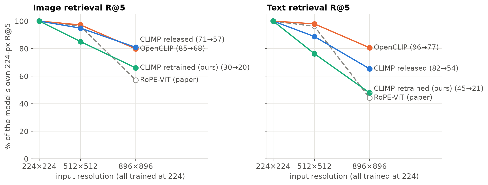

| (top-1 / R@1) | Ours retrained | Released |
|---|---|---|
| ImageNet-V2 / **ImageNet-O** | 13.9 / **22.5** | 37.6 / **49.8** |
| DOCCI full captions @896 (img / txt) | **2.8 / 2.5** | 37.3 / 23.8 |
| Hubness image (↓) | **19.7** | 1.55 |

- **No graceful high-res behaviour:** −34% / −52%, like the paper's RoPE-ViT. It comes from scale, not the architecture alone
- **ImageNet-O is still the best variant** (as released)
- **Long text needs a trained text tower**

<!--
(~60 s) The figure shows each model's NoCaps R@5 relative to its own 224-pixel score. The released CLIMP keeps 81 and 65 percent at 896; our retrained one keeps only 66 and 48 — about as steep as the paper's RoPE-ViT baseline. Same code, same no-position-embedding design, so the graceful degradation must come from large-scale training rather than from the architecture by itself.
ImageNet-O remains our model's best ImageNet variant, the same ordering as the released model.
DOCCI collapses to about 3 percent: the frozen Mamba can read 578 tokens, but our projection only ever saw 11-token COCO captions. So "any caption length" is an architectural ability; retrieving well with long text has to be learned — consistent with the authors fine-tuning their text tower.
Huge image hubness shows an under-trained embedding space. All absolute numbers are low because of 100x less data — read this as trends.
-->

---

<!-- header: E · Critical analysis -->

## Strengths and limitations

### Strengths
- **Released artefacts are trustworthy:** 32/34 numbers matched within 0.5 pp
- **Clean, real mechanisms:**
  - any resolution with one set of weights (verified)
  - any caption length, and it helps (+9.2 pp)
  - 1.8× fewer FLOPs at 896 px
- **Controlled comparison:** same data and recipe isolate the architecture
- **A simple, convincing bias test** (CIFAR), reproduced over 3 seeds

### Limitations
- **Weak, unreleased baselines.** Their RoPE-ViT reaches 34.9 text R@5 at 896; an off-the-shelf ViT gets 77.2
- **Headline rests on one dataset:** the "beats 167× data" claim is ImageNet-O only
- **Memory claim under-specified;** reversed against fused attention
- **Geometry → accuracy asserted, not shown;** hubness *k* unstated (text says 1.13, table says 1.15)
- **Small-scale bias ≠ pretrained behaviour** (patch-shuffle test)
- **Minor issues:**
  - Table 4's I→T / T→I labels appear swapped
  - CLIMP still drops 19–35% at 896 px

<!--
(~60 s) Strengths first: the released models are honest — I got their numbers to within half a point. The mechanisms are real: one set of weights at every resolution, long text that genuinely helps, fewer FLOPs. The controlled-training design is the right way to study architecture. And the CIFAR experiment is simple and convincing.
Limitations: the biggest is the baselines. They're trained by the authors, unreleased, and much weaker than a standard public ViT — at 896 pixels their RoPE-ViT gets 35 text R@5 where OpenCLIP gets 77. So part of the resolution advantage may be baseline weakness.
The headline OOD claim rests on ImageNet-O alone. The memory figure isn't defined and flips against fused attention. The geometry explanation is correlational. And presentation issues: swapped column labels, a 1.13 vs 1.15 inconsistency.
-->

---

## Is the evidence sufficient? Assumptions and improvements

### Sufficient?
- For **"SSMs are a viable CLIP backbone at equal data"**: largely **yes**
- For **"better than Transformers"**: **no**. That would need tuned, released baselines, one larger-data comparison, memory measured with fused attention, and error bars on the big models

### Assumptions the method makes
- **4 one-dimensional scans ≈ 2-D neighbourhoods.** Only partly: vertical neighbours are far apart in a row scan
- **The last token of a causal LM is a good sentence embedding.** It works, but word order goes unused (SugarCrepe)
- **Training at 224 px suffices for any resolution.** It runs, but accuracy still falls

### What I would improve
1. **Release baselines;** define memory precisely (peak allocated, batch size, attention kernel)
2. **Hubness-aware inference** (CSLS / inverted softmax): free, +4.5 to +9.3 pp R@1
3. **Brief high-resolution fine-tuning** of the projection layers
4. **Compositional hard negatives** (NegCLIP-style) to use the LM's word-order sensitivity
5. **Test bias claims on the pretrained model** (my patch-shuffle protocol), not only on CIFAR

<!--
(~60 s) Is the evidence enough? For the modest claim — SSMs work as a CLIP backbone at equal data — yes. For "better than Transformers" — no: that needs strong, public baselines, at least one larger-scale run, a precise memory protocol, and error bars.
Assumptions: four 1-D scans only approximate 2-D neighbourhoods; last-token pooling works but word order isn't exploited; training at 224 doesn't make 896 free.
What I'd change: release baselines and define memory; use hubness correction at inference, which is free accuracy; fine-tune briefly at high resolution; add hard-negative captions; and test inductive-bias claims on the pretrained model, as my patch-shuffle experiment does.
-->

---

<!-- header: F · Impact -->

## Impact, relation to LLMs, and conclusion

### Where this fits
- Part of the shift to **sub-quadratic and hybrid models**: Mamba, Mamba-2, and hybrid Mamba–Transformer LLMs (Jamba, Nemotron)
- **Decoder LLMs as embedding models:** last-token pooling of a causal LM, as in LLM2CLIP and LLM-based text embedders
- **Vision encoders for multimodal LLMs:** documents and charts mean thousands of visual tokens. Linear compute and no position table are attractive, but memory needs a fair comparison
- **Long-context retrieval:** reading the whole description matters (+9.2 pp)
- Published 2026, so its long-term influence is not yet visible

### Conclusion
- ✓ Released CLIMP reproduces: NoCaps at all resolutions, ImageNet variants, DOCCI, geometry, FLOPs, CIFAR bias
- ✗ Not robust to a broader test: the memory saving, hubness values, and advantages over a strong ViT (ImageNet-O excepted)
- NEW Long text helps (+9.2 pp) · CSLS +9.3 pp · pretrained layout sensitivity = ViT's · weak at word order
- NEW Retrained on COCO: it learns, but resolution robustness and long-text retrieval do **not** appear at small scale

<b>Mamba is a viable CLIP backbone, but not yet a better one.</b>

<!--
(~60 s) Impact: CLIMP is part of a broader move away from pure Transformers toward linear-time and hybrid models — Mamba, Mamba-2, and production hybrid LLMs. Its text side mirrors the trend of using decoder LLMs, with last-token pooling, as embedding models.
For multimodal LLMs, a vision encoder that's linear in the number of patches and has no position table is attractive for documents and charts — but my results say you must compare against fused attention before claiming memory savings.
Conclusion: the released model is exactly as reported; three broader claims don't survive a stronger comparison; and my additions show long text helps, hubness correction is free accuracy, and compositionality is a weak spot. One line: Mamba is a viable CLIP backbone, not yet a better one.
-->

---

<!-- header: "" -->

## Team Contribution

| Student | Contribution | Score |
|---|---|---|
| **Tanish Wanve** | Equal (sole member) | **1.0** |

**Understanding and presentation:** read the paper and the upstream code; report; slides; Q&A preparation

**Experiments (8):** NoCaps retrieval at 3 resolutions, embedding geometry, zero-shot ImageNet-V2/R/A/O, DOCCI long captions, memory/FLOPs, CIFAR inductive bias (3 seeds), plus 4 new analyses

**Engineering:**
- evaluation code with unit tests, verified against upstream
- correctness gate
- two-GPU Kaggle pipeline
- CLIMP retraining pipeline (distributed loss tested to equal the full batch)
- fixes for out-of-memory and dataset-loader failures
- every table and figure generated from result files

Single-member project, built with an AI coding assistant. All analysis, interpretation and choices are my own.

<!--
(~20 s) The guidelines ask for a Team Contribution slide. This was a single-member project, so the score is 1.0. The left column is the understanding and experiment work, the right column the engineering. Thank you — happy to take questions.
-->

---

<!-- header: Appendix -->
<!-- _paginate: false -->

## Appendix A — full NoCaps retrieval (E1)

| Model | Res | Image R@1 / R@5 / R@10 | Text R@1 / R@5 / R@10 |
|---|---|---|---|
| CLIMP-Mamba1 | 224 | **38.2 / 70.5 / 81.8** (README 38.2 / 70.5 / 81.8) | **51.8 / 81.9 / 90.9** (README 51.8 / 81.9 / 90.9) |
| CLIMP-Mamba1 | 512 | 34.2 / 66.9 / 79.2 | 42.2 / 72.7 / 83.8 |
| CLIMP-Mamba1 | 896 | 26.2 / 57.1 / 70.8 | 25.3 / 53.5 / 66.5 |
| CLIMP-Mamba2 | 224 | 37.4 / 70.2 / 81.7 (README 37.4 / 70.2 / 81.6) | 51.0 / 81.2 / 90.3 (README 51.0 / 81.3 / 90.9) |
| CLIMP-Mamba2 | 896 | 25.8 / 57.1 / 70.8 | 24.5 / 53.9 / 66.6 |
| OpenCLIP ViT-B/16 | 224 | 58.0 / 84.6 / 91.2 | 80.0 / 95.7 / 98.2 |
| OpenCLIP ViT-B/16 | 512 | 54.3 / 82.2 / 89.6 | 74.4 / 93.8 / 97.2 |
| OpenCLIP ViT-B/16 | 896 | 39.4 / 67.6 / 77.9 | 51.7 / 77.2 / 84.9 |

Image retrieval = text query → images; text retrieval = image query → captions (upstream definitions). Mamba-2 @512: 33.9 / 66.4 / 79.2 and 40.5 / 72.4 / 83.5.

---

## Appendix B — implementation and deviations

**Pipeline**
- `src/exp_*.py`: one script per experiment; each writes a JSON with its config, library versions, GPU, git hashes, runtime and peak RAM
- `src/make_results.py`: builds every table and figure from those JSONs only. No hand-typed numbers
- Unit tests, including recall@k identical to upstream `eval_nocaps.py`
- **Smoke runs first** on tiny subsets; they caught an out-of-memory error on long DOCCI captions and a library conflict
- Upstream code pinned at commit `3ff1279`, never edited

**Deviations** (all in ASSUMPTIONS.md)
- Baseline: OpenCLIP ViT-B/16 (LAION-2B) instead of the unreleased RoPE-ViT / FlexViT / NaFlex + LLaMA
- Hubness *k* = 10 (unstated in the paper); CSLS is transductive
- E8: a fresh per-image patch permutation; 20 epochs (unstated in the paper)
- Datasets loaded from official parquet / jsonl mirrors (same rows and order)
- E3 uses ImageNet-V2/R/A/O; ImageNet-Sketch was not run

