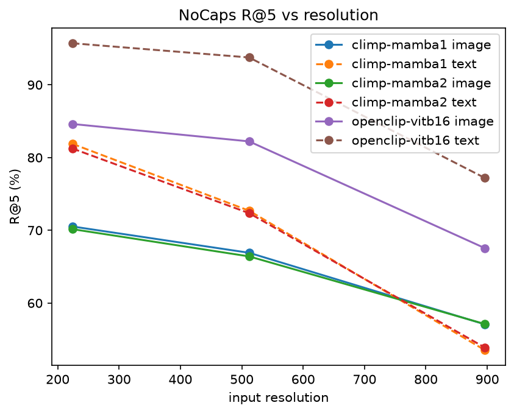
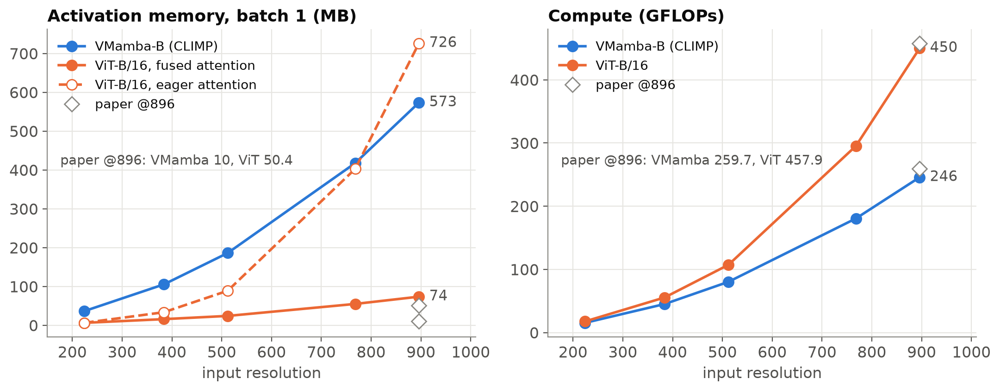
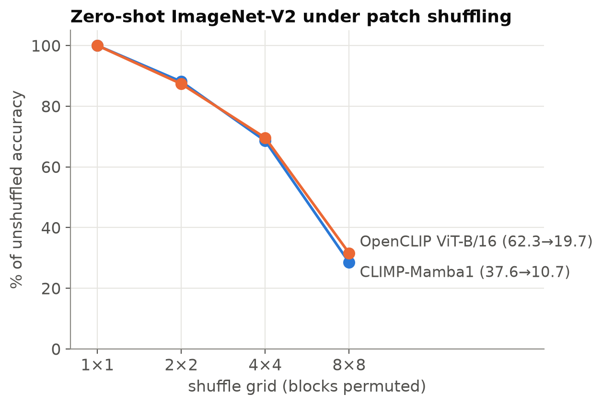

# CLIMP: Contrastive Language-Image Mamba Pretraining — A Reproduction and Critical Study

**CS613 paper presentation report** · Tanish Wanve
Paper: N. Shabtay, I. Zimerman, E. Schwartz, R. Giryes, *CLIMP: Contrastive Language-Image Mamba Pretraining*, arXiv 2601.06891 (v2).
Code: <https://github.com/tanishwanve-git/climp-cs613> (upstream: <https://github.com/NimrodShabtay/CLIMP>, commit `3ff1279`).

---

## Abstract

CLIP-style models pair a Vision Transformer (ViT) with a Transformer text encoder. This design has three known weaknesses:

- Attention cost grows quadratically with the number of image patches.
- The text encoder reads at most 77 tokens.
- Attention can latch onto spurious correlations.

CLIMP replaces **both** towers with state-space models (SSMs): VMamba for images and a pretrained Mamba language model for text. The paper claims that this gives better retrieval, better out-of-distribution (OOD) robustness, native any-resolution inference with lower memory and FLOPs, long-caption retrieval, and a measurable spatial inductive bias.

We re-evaluated the two released checkpoints on eight experiments on 2× Tesla T4. We added a strong, publicly available ViT-B/16 CLIP baseline and four analyses that are not in the paper.

**What reproduces.** Every number we could recompute from the released weights matches the paper to within 0.1–0.4 pp:

- NoCaps retrieval at 224/512/896 px (all of Table 4);
- the four ImageNet variants of Table 2 (top-5 exact; top-1 within 0.4 pp except ImageNet-O);
- DOCCI long-caption retrieval (Table 6);
- the alignment and uniformity of Table 8;
- the FLOP counts of Fig. 3;
- the qualitative pattern of the CIFAR-10 inductive-bias experiment (Table 7).

**What does not reproduce or does not generalise:**

- **Memory.** The 5× memory advantage depends on how attention is implemented. Against a ViT with modern fused attention, VMamba uses **7.8× more** activation memory at 896 px.
- **Hubness.** Our hubness values are higher than the paper's.
- **Baseline strength.** Against a CLIP ViT-B/16 trained on more data, CLIMP's retrieval, zero-shot, long-caption and compositional advantages disappear. ImageNet-O is the only exception.

**New findings:**

- CSLS re-scoring improves CLIMP's text R@1 by +9.4 pp.
- Long captions really help CLIMP (+9.2 pp image R@1 from 77 tokens to full captions).
- The pretrained CLIMP is **not** more sensitive to patch shuffling than a ViT.
- CLIMP is near chance on SugarCrepe's word-order (swap) tests.

---

## 1. Problem and motivation

### 1.1 What problem does the paper solve?

CLIP [Radford et al. 2021] learns a shared image–text embedding space from image–caption pairs. It is the backbone of zero-shot classification, retrieval, and the vision side of most multimodal LLMs. Standard CLIP uses Transformers on both sides, and the paper names three limitations of that design.

1. **Quadratic cost in image resolution.**
   - A ViT-B/16 at 224 px sees 14×14 = 196 patches. At 896 px it sees 56×56 = 3,136 patches.
   - Self-attention compares every patch with every other patch, so its cost grows with the square of the patch count: 16× more pixels means 256× more attention entries.
   - High-resolution inputs such as documents, satellite images and dense scenes therefore become expensive.
   - A ViT also has learned positional embeddings for one grid size. Running it at another size needs interpolation, RoPE, or special training (FlexViT, NaFlex).
2. **Fixed 77-token text context.**
   - CLIP's text Transformer has 77 learned positions, and anything longer is cut off.
   - Dense captions are much longer: DOCCI averages ~142 tokens, and 94% of its captions exceed 77.
3. **Spurious correlations and distribution shift.** Pairwise attention can rely on spurious, non-robust cues [Wang et al. 2024], which hurts OOD robustness.

### 1.2 Why is it important?

Contrastive encoders are infrastructure: their weaknesses propagate into every downstream system built on them. A backbone with linear cost in sequence length, no fixed resolution and no fixed text length would directly benefit:

- high-resolution retrieval;
- long-description retrieval;
- the efficiency of the vision encoders inside vision-language LLMs.

### 1.3 Limitations of existing approaches and what motivated the authors

- **Transformer workarounds.** FlexViT, NaFlex and RoPE-ViT add machinery to make ViTs resolution-flexible, but the quadratic cost remains.
- **LLMs as text towers.** LLM2CLIP and UniViTAR use LLMs as text towers, but they keep a Transformer on the vision side.
- **Prior Mamba-for-CLIP work.** CLIP-Mamba [Huang et al. 2024] put Mamba into CLIP only partially (hybrid towers), with a narrow evaluation.
- **The opportunity.** Mamba [Gu & Dao 2023] and VMamba [Liu et al. 2024] had shown linear-time sequence modelling and competitive ImageNet accuracy, plus a spatial inductive bias (locality and smoothness) that ViTs lack.

The authors' hypothesis is that a **fully** SSM-based CLIP inherits all of these benefits at once.

---

## 2. Key contribution

**Central idea.** Build CLIP from SSMs on both sides:

- **vision:** VMamba-B, with its 2-D selective scan (SS2D);
- **text:** a pretrained Mamba-1 (1.4 B) or Mamba-2 (1.3 B) language model, using the hidden state of the last token as the sentence embedding.

Both towers are trained with the standard CLIP contrastive loss.

**What is new:**

1. It is the first CLIP model in which **both** encoders are Mamba-based.
2. The evaluation is controlled: every model is trained on CC12M with the same recipe, which isolates the effect of the architecture.
3. The evaluation is broad: retrieval, OOD, resolution, dense captions, embedding geometry, efficiency, scaling, and inductive bias.

**Main insight.** The scan order of VMamba *is* its positional information. VMamba has no positional embedding to interpolate, so the same weights run at any resolution. The recurrence decays with distance (for Mamba-2 the transition is Ā = λI, so a state k steps back is weighted by λᵏ), which gives a locality bias.

On the text side, a causal recurrent model has no position table. It reads arbitrarily long text, and its last hidden state summarises the whole input.

**Why it should work, according to the authors:**

- **Retrieval.** Better retrieval comes from tighter alignment and lower hubness in the embedding space (paper Table 8).
- **ImageNet-O.** The OOD gains (notably ImageNet-O) come from the spatial bias, which reduces reliance on spurious features.
- **Efficiency.** It comes from the linear-time scan.

The paper's headline numbers (CLIP-Benchmark average of 31 datasets, all trained on CC12M) are below. These are **paper** numbers, given for context; we cannot recompute them because the baselines are not released.

| Vision | Text | Acc@1 | Acc@5 | IR@5 | TR@5 |
|---|---|---|---|---|---|
| ViT-B/16 | LLaMA-3.2-1B | 27.3 | 56.4 | 62.8 | 72.9 |
| RoPE-ViT-B/16 | LLaMA-3.2-1B | 27.3 | 59.0 | 63.4 | 72.9 |
| CLIMP (VMamba-B) | Mamba-2 | 26.9 | 59.0 | 65.2 | 75.3 |
| CLIMP (VMamba-B) | Mamba-1 | **29.6** | 58.5 | **65.5** | **77.0** |

*Paper Table 1 (excerpt).*

---

## 3. Method

### 3.1 State-space models (SSMs)

An SSM maps an input signal x(t) to an output y(t) through a hidden state h(t) ∈ ℝᴺ:

  h′(t) = A h(t) + B x(t),  y(t) = C h(t) + D x(t)

- **A** says how the memory evolves (how fast it forgets).
- **B** says how much of the input is written into memory.
- **C** says what is read out.
- **D** is a skip connection.

For token sequences the system is **discretised** with a step size Δ. Mamba uses the zero-order hold (ZOH) rule:

  Ā = exp(ΔA),  B̄ = (ΔA)⁻¹(exp(ΔA) − I)·ΔB,  hₜ = Ā hₜ₋₁ + B̄ xₜ,  yₜ = C hₜ + D xₜ.

In words:

- hₜ is a running summary of everything seen so far.
- Each step decays the old summary by Ā and adds the new token through B̄.
- A large Δ means "reset and focus on this token"; a small Δ means "keep the past, mostly ignore this token".

The cost is **linear** in sequence length L, compared with O(L²) for attention.

### 3.2 Selectivity: Mamba-1 vs. Mamba-2

**Mamba-1** makes B, C and Δ functions of the current input xₜ. This *selection* lets the model decide, token by token, what to store and what to forget. That is what makes it competitive with attention on language. Because the parameters vary per token, the model can no longer be computed as a convolution; Mamba uses a hardware-aware parallel scan instead.

**Mamba-2** restricts A to a scalar times the identity (A = aI) and shares parameters across heads. This structure (state-space duality, SSD) lets the recurrence be computed as blocked matrix multiplications, which is 2–8× faster. The cost is expressivity: Mamba-2 has one decay rate per head instead of one per channel.

The paper finds that Mamba-1 is slightly better for contrastive alignment (Table 1), and our NoCaps results agree (§5.1).

### 3.3 Vision tower: VMamba and the SS2D cross-scan

An image is not a 1-D sequence. VMamba handles this in four steps:

1. Split the image into patches.
2. Unfold the patch grid into **four** 1-D sequences: row-major, column-major, and both of these reversed.
3. Run a selective scan along each sequence.
4. Add the four outputs back at each patch position.

After the four scans, every patch has received information from every direction, so its receptive field is global. The cost is still linear in the number of patches.

VMamba-B is hierarchical (4 stages with patch merging, like a CNN), and its pooled output is projected to the 768-d joint space by W_v.

CLIMP turns positional embeddings off. In the upstream code, `posembed=False`, and `imgsize` only affects the positional embedding. Position is therefore encoded only by scan order, and **one set of weights serves every resolution**. We verified that the parameter names and shapes are identical at 224 and 896 px (log line in `results/logs/E1.log`).

### 3.4 Text tower: last-token pooling

The text tower is a pretrained Mamba LM. For tokens t₁…t_L with a padding mask, the text embedding is the last layer's hidden state at the last non-padding position, projected by W_t:

  t_raw = H_k,  k = max{ i : token i is not padding }  (paper Eq. 1)

The model is causal: each hₜ depends only on tokens ≤ t. The last real token is therefore the only position that has seen the whole caption, which makes it the natural summary. This is the same reason GPT-style embedding models use the last token.

Because the model has no position table, captions of any length are accepted. A consequence we verified: padding on the right (Mamba-1 tokenizer) or the left (Mamba-2 tokenizer) never changes the embedding (cosine similarity 1.00000 in the E1 check).

### 3.5 Objective and training

CLIMP keeps CLIP's symmetric InfoNCE loss. For a batch of N pairs with normalised embeddings vᵢ (image) and tᵢ (text), and learned temperature τ:

  L = −(1/2N) Σᵢ [ log softmaxⱼ(vᵢ·tⱼ/τ)ᵢ + log softmaxⱼ(tᵢ·vⱼ/τ)ᵢ ]

In words, in each row and column of the N×N similarity matrix, the true pair should score highest. The other N−1 captions in the batch act as negatives, which is why CLIP needs large batches.

**Training setup (paper):**

- **Data:** CC12M, 10 epochs, 224 px.
- **Optimiser:** AdamW, cosine schedule, peak learning rate 5e-5.
- **Batch and embedding size:** batch 2048, joint dimension 768.
- **Initialisation:** vision towers from ImageNet-1K; text towers from the pretrained LMs.
- **Baselines:** RoPE-ViT, FlexViT and NaFlex, each with LLaMA-3.2-1B as the text tower, trained identically.

### 3.6 Important design decisions

| Decision | Why |
|---|---|
| SSM on both sides | Linear cost and no fixed length on either modality. Ablation (Table 10): VMamba + Mamba text beats VMamba + LLaMA by +3.5 Acc@1, a "matched architecture" synergy. |
| Autoregressive (causal) LM, not a bidirectional SSM | Mature pretrained LMs exist; the bidirectional Hydra was worse in Table 10. |
| No positional embeddings in VMamba | Any-resolution inference without interpolation or extra training. |
| Controlled CC12M training | Separates the effect of the architecture from the effect of the data. |

---

## 4. Our study: setup and implementation

### 4.1 Scope

Retraining CLIMP on CC12M (2048 batch × 10 epochs with 1.4 B-parameter text towers) is far beyond a student budget. We therefore **evaluate the released checkpoints** (`NimrodShabtay1986/CLIMP-Mamba1`, `-Mamba2`) and retrain only the paper's small CIFAR-10 experiment.

The paper's baselines (RoPE-ViT, FlexViT and NaFlex with LLaMA) are not released. As a reference we use **OpenCLIP ViT-B/16 trained on LAION-2B** (`laion2b_s34b_b88k`):

- It is the model the paper itself cites for its ImageNet-O claim.
- It is a widely used, strong public CLIP with a vision tower of the same size (ViT-B/16, 86 M parameters vs. VMamba-B's 88 M).

**This is not a controlled comparison.** OpenCLIP was trained on LAION-2B, a dataset about 167× larger than CC12M. It tells us how CLIMP compares to a CLIP that people actually use, not whether the architecture is better at equal data.

### 4.2 Experiments

| ID | Experiment | Data (size) | Paper ref. | Type |
|---|---|---|---|---|
| E1 | NoCaps retrieval @224/512/896 px + correctness gate | NoCaps val (4,500 images, 45,000 captions) | Table 4, README | Reproduction |
| E2 | Alignment / uniformity / hubness; CSLS correction | NoCaps @224 | Table 8 | Reproduction + **new** |
| E3 | Zero-shot ImageNet-V2 / R / A / O | 10,000 / 30,000 / 7,500 / 2,000 images | Table 2 | Reproduction |
| E4 | Zero-shot under G×G patch shuffle (G = 2, 4, 8) | ImageNet-V2 | – | **New** |
| E5 | DOCCI long-caption retrieval @896, text cut at 77 / 154 / full | DOCCI test (5,000 pairs) | Table 6 | Reproduction + **new** |
| E6 | Vision-encoder memory and FLOPs, 224–896 px | – | Fig. 3 | Reproduction + **new** |
| E7 | SugarCrepe compositionality (7 subsets) | 7,511 items, COCO val2017 | – | **New** |
| E8 | Tiny VMamba vs. ViT on CIFAR-10, regular vs. patch-shuffled, 3 seeds | CIFAR-10 (50,000 / 10,000) | Table 7 | Reproduction |

### 4.3 Metrics

- **Recall@k (R@k):** the fraction of queries with at least one correct item in the top k.
  - *Image retrieval* means text query → images.
  - *Text retrieval* means image query → captions.

  Our implementation is unit-tested to give identical numbers to upstream `eval_nocaps.py`.
- **Alignment** [Wang & Isola 2020]: E‖vᵢ − tᵢ‖² over matched pairs. Lower means matched pairs are closer.
- **Uniformity:** log E exp(−2‖xᵢ − xⱼ‖²). Lower means the embeddings are spread more evenly over the sphere.
- **Hubness** [Radovanović et al. 2010]: the skewness of N_k, where N_k(g) counts how many queries have gallery item g among their k nearest neighbours.
  - High skew means a few "hub" items appear in many neighbour lists and crowd out the correct answers.
  - We use k = 10 because the paper does not state k.
- **CSLS** [Conneau et al. 2018]:
  - score(q, g) = 2·cos(q, g) − r_q − r_g, where r is an item's mean similarity to its 10 nearest cross-modal neighbours.
  - It penalises hubs. It is *transductive*: it uses the test set's own neighbourhoods.
- **Zero-shot accuracy:** top-1 and top-5 accuracy with class-name prompts averaged over the 80 OpenAI templates (the CLIP-Benchmark protocol).
- **SugarCrepe accuracy:** an item counts as correct if sim(image, true caption) > sim(image, hard-negative caption). Chance is 50%.

### 4.4 Implementation summary

The code is our own and contains no copies of upstream code. It imports the upstream model code from an untouched, pinned clone (`CLIMP/` at commit `3ff1279`).

```
src/common.py          model loading (CLIMP + OpenCLIP), batched encoding, patch shuffle, seeding, run metadata
src/metrics.py         recall@k, alignment, uniformity, hubness, CSLS (pure torch)
src/exp_*.py           one script per experiment (E1–E8); each writes results/<name>.json with config,
                       library versions, GPU, git hashes, runtime and peak RAM
src/make_results.py    builds every table (Markdown + LaTeX) and figure ONLY from results/*.json
tests/test_metrics.py  11 unit tests (recall vs upstream code, metrics, patch shuffle, batching)
kaggle/run_climp.ipynb two-GPU runner (one job queue per T4), staged runs, per-job timeouts
ASSUMPTIONS.md         every deviation and interpretation, one line each
```

**Safeguards for correctness:**

1. **Correctness gate.**
   - E1 compares CLIMP-Mamba1 @224 with the README numbers and stops the pipeline if any differs by more than 0.5 pp.
   - It also checks that our tokenisation (`padding="longest"`) gives the same embeddings as upstream's padding (cosine similarity 1.00000).
   - It also checks that one VMamba instance has identical parameters at every resolution.
2. **Smoke tests first.** Every script has a `--smoke` mode on a tiny subset. These runs caught two real failures before the full runs: an out-of-memory error on long DOCCI captions, and a library conflict.
3. **No hand-typed numbers.** Every number in our tables is produced by `make_results.py` from the result JSONs. The paper's numbers live in `paper_numbers.json`.
4. **Fixed seeds and recorded environment.** Seeds are fixed (E8 uses seeds 0, 1 and 2), and every result records library versions and git commits.

**Engineering issues we solved:**

- **Long DOCCI captions ran out of GPU memory on a 16 GB T4.** The upstream text encoder keeps the hidden states of all 49 layers. We batch by a token budget (≤ 4,096 tokens per batch) instead of a fixed count, which leaves the outputs unchanged.
- **Compiling Mamba's CUDA kernels takes 40–60 min.** We pinned torch 2.10, which has official prebuilt wheels, and self-test the kernels on the GPU.
- **The NoCaps and DOCCI Hugging Face loaders no longer run.** We read the official parquet and jsonlines files instead, preserving the row order.
- **E8 has to fit Kaggle's 4 CPU cores.** CIFAR-10 is kept on the GPU, and augmentation (crop, flip, per-image patch shuffle) runs batched on the GPU.

**Compute.** Kaggle, 2× Tesla T4 (16 GB), fp16 autocast (the same precision as upstream evaluation). The work ran in two stages:

- **Stage 1 (E1, E2, E6, E8):** about 3 h wall clock, dominated by E1's 896-px passes.
- **Stage 2 (E3, E4, E5, E7):** shorter; it ran after the stage 1 correctness gate had been checked.

Peak CPU RAM was 10 GB out of 34 GB.

---

## 5. Reproduction results (ours vs. paper)

### 5.1 E1 — NoCaps retrieval and resolution scaling (Table 4)

| Model | Res | Image R@1 / R@5 / R@10 | Text R@1 / R@5 / R@10 |
|---|---|---|---|
| CLIMP-Mamba1 | 224 | **38.2 / 70.5 / 81.8** (README 38.2 / 70.5 / 81.8) | **51.8 / 81.9 / 90.9** (README 51.8 / 81.9 / 90.9) |
| CLIMP-Mamba1 | 512 | 34.2 / 66.9 / 79.2 | 42.2 / 72.7 / 83.8 |
| CLIMP-Mamba1 | 896 | 26.2 / 57.1 / 70.8 | 25.3 / 53.5 / 66.5 |
| CLIMP-Mamba2 | 224 | 37.4 / 70.2 / 81.7 (README 37.4 / 70.2 / 81.6) | 51.0 / 81.2 / 90.3 (README 51.0 / 81.3 / 90.9) |
| CLIMP-Mamba2 | 512 | 33.9 / 66.4 / 79.2 | 40.5 / 72.4 / 83.5 |
| CLIMP-Mamba2 | 896 | 25.8 / 57.1 / 70.8 | 24.5 / 53.9 / 66.6 |
| OpenCLIP ViT-B/16 | 224 | 58.0 / 84.6 / 91.2 | 80.0 / 95.7 / 98.2 |
| OpenCLIP ViT-B/16 | 512 | 54.3 / 82.2 / 89.6 | 74.4 / 93.8 / 97.2 |
| OpenCLIP ViT-B/16 | 896 | 39.4 / 67.6 / 77.9 | 51.7 / 77.2 / 84.9 |

R@5 against paper Table 4:

| Model | Res | Image R@5 ours / paper | Text R@5 ours / paper |
|---|---|---|---|
| CLIMP-Mamba1 | 224 | 70.5 / 70.5 | 81.9 / 81.9 |
| CLIMP-Mamba1 | 512 | 66.9 / 66.9 | 72.7 / 72.7 |
| CLIMP-Mamba1 | 896 | 57.1 / 57.1 | 53.5 / 53.5 |
| CLIMP-Mamba2 | 224 | 70.2 / 70.2 | 81.2 / 81.3 |
| CLIMP-Mamba2 | 512 | 66.4 / 66.4 | 72.4 / 72.4 |
| CLIMP-Mamba2 | 896 | 57.1 / 57.1 | 53.9 / 53.8 |



*Figure 1 (ours). NoCaps R@5 vs. input resolution. Solid lines are image retrieval, dashed lines are text retrieval.*

**Agreement.**

- CLIMP-Mamba1 reproduces the README exactly (all six numbers within 0.05 pp), and both variants reproduce every cell of paper Table 4 within 0.1 pp.
- The one deviation is Mamba-2 text R@10: 90.3 vs. the README's 90.9 (−0.6 pp). The README lists 90.9 for both models in that cell, which may be a copying error; we report the value as measured.
- Paper Table 4 labels its columns "I→T / T→I", but its values equal the README's *image / text retrieval*. The labels appear swapped.

**Interpretation.**

- **The paper's comparison holds.** Against its own baselines, CLIMP degrades "far more gracefully". RoPE-ViT falls to 38.6 / 34.9 R@5 at 896 px, while CLIMP keeps 57.1 / 53.5.
- **It does not hold against a stronger ViT.** OpenCLIP ViT-B/16 uses plain interpolated positional embeddings, yet it stays above CLIMP at every resolution.
- **It degrades at a similar rate.** From 224 to 896 px, image R@5 falls by about 20% for OpenCLIP and 19% for CLIMP.
- **CLIMP's text retrieval degrades faster:** it loses 35% (81.9 → 53.5), while OpenCLIP loses 19% (95.7 → 77.2).
- "Any resolution without positional embeddings" is real: the model runs and the numbers match. But it does not translate into *better* high-resolution accuracy than a well-trained ViT.

### 5.2 E2 — Embedding geometry (Table 8)

| Model | Source | Alignment ↓ | Unif. image ↓ | Unif. text ↓ | Hubness image ↓ | Hubness text ↓ |
|---|---|---|---|---|---|---|
| CLIMP-Mamba1 | **ours** | **0.982** | **−3.184** | **−3.546** | 1.554 | 1.787 |
| CLIMP-Mamba1 | paper | 0.982 | −3.18 | −3.54 | 1.01 | 1.15 |
| OpenCLIP ViT-B/16 | ours | 1.437 | −2.724 | −2.736 | 1.685 | 4.124 |

**Agreement.** Alignment and both uniformity values match the paper to the reported precision. This strongly suggests that we compute these metrics the same way: one caption per image, Wang & Isola's definitions.

**Gap.** Our hubness values are 0.5–0.6 higher. The paper does not specify k or how N_k is computed, so the absolute values are not comparable. The paper's text also says 1.13 while its Table 8 says 1.15.

**Our comparison is internally consistent.** We use the same k for both models, and CLIMP shows much better alignment (0.98 vs. 1.44) and **much less text-side hubness (1.79 vs. 4.12)** than OpenCLIP. The paper's geometric argument (tight alignment and low text hubness) therefore holds against OpenCLIP too.

**But geometry is not accuracy.** OpenCLIP has the worse geometry yet the much better retrieval (§5.1). Alignment and hubness alone do not explain retrieval quality, which weakens the paper's causal story ("better geometry → better retrieval").

### 5.3 E3 — Zero-shot OOD robustness (Table 2)

| Model | IN-V2 top-1 / 5 | IN-R top-1 / 5 | IN-A top-1 / 5 | IN-O top-1 / 5 |
|---|---|---|---|---|
| CLIMP-Mamba1 (**ours**) | **37.6** / 68.4 | **46.6** / 74.5 | **15.6** / 45.3 | **49.8** / 78.8 |
| CLIMP-Mamba1 (paper) | 37.5 / 68.4 | 46.2 / 74.5 | 15.5 / 45.3 | 48.1 / 78.8 |
| RoPE-ViT + LLaMA (paper, best baseline) | 34.4 / 65.4 | 47.8 / 76.0 | 16.3 / 46.3 | 40.1 / 69.9 |
| OpenCLIP ViT-B/16 (ours) | 62.3 / 87.0 | 80.6 / 94.0 | 38.2 / 70.6 | 46.4 / 77.3 |
| OpenCLIP ViT-B/16 (paper, quoted) | – | – | – | 42.3 / – |

**Agreement.**

- All four top-5 values match exactly, and top-1 is within 0.4 pp on V2, R and A.
- On ImageNet-O our top-1 is 49.8 vs. the paper's 48.1. The difference is small, and the small test set (2,000 images) is one plausible source. Note also that 49.8 is exactly the paper's *Mamba-2* ImageNet-O top-1, which raises the possibility of a row mix-up in the paper's table; we cannot verify this.

**The ImageNet-O claim survives.** CLIMP (49.8) beats OpenCLIP ViT-B/16 trained on LAION-2B (46.4 in our run, 42.3 quoted by the paper). The margin is smaller in our measurement: 3.4 pp instead of 5.8 pp.

**The broader robustness story does not.** On V2, R and A, OpenCLIP leads by 23–34 pp. Averaged over the four sets, OpenCLIP scores 56.9 top-1 vs. CLIMP's 37.4.

- ImageNet-O is unusual. It was built for OOD *detection*: images from outside ImageNet-1K's classes that ResNet-50 confidently misclassifies.
- Accuracy on it is a narrow and somewhat unusual signal, not a measure of general robustness.
- In our view, the claim "architectural bias can outweigh data scale" rests on this single dataset.

### 5.4 E5 — DOCCI long-caption retrieval @896 px (Table 6)

| Model | Text length | Image R@1 / R@5 / R@10 | Text R@1 / R@5 / R@10 |
|---|---|---|---|
| CLIMP-Mamba1 (**ours**) | full | **37.3 / 67.0 / 77.8** | **23.8 / 50.4 / 62.7** |
| CLIMP-Mamba1 (paper) | full | 37.3 / 67.1 / 77.8 | 23.8 / 50.4 / 62.7 |
| NaFlex + LLaMA (paper, best baseline) | full | 29.1 / 55.3 / 67.5 | 26.1 / 53.4 / 65.1 |

**Agreement.** All six numbers match the paper exactly, except image R@5, which differs by 0.1 pp. Our caption statistics also match: mean 142.6 tokens, 94.5% of captions over 77 tokens, longest 578 (paper: ~142 and 94.4%). The truncation ablation and the OpenCLIP comparison are new and appear in §6.3.

### 5.5 E6 — Vision-encoder efficiency (Fig. 3)

Batch 1, fp16, one forward pass. Activation memory = peak memory − (weights + input).

| Model | Quantity | 224 | 384 | 512 | 768 | 896 | Paper @896 |
|---|---|---|---|---|---|---|---|
| VMamba-B | GFLOPs | 15.4 | 45.1 | 80.2 | 180.5 | **245.7** | 259.7 |
| ViT-B/16 | GFLOPs | 17.6 | 55.5 | 107.1 | 295.3 | **450.0** | 457.9 |
| VMamba-B | activation MB | 36.4 | 105.4 | 186.1 | 417.7 | **573.5** | 10.0 |
| ViT-B/16, fused attention (default) | activation MB | 6.3 | 15.9 | 24.1 | 55.0 | **73.7** | 50.4 |
| ViT-B/16, eager attention | activation MB | 6.3 | 33.7 | 89.0 | 402.7 | **726.3** | – |



*Figure 2 (ours). Left: activation memory. Right: GFLOPs (the two ViT curves coincide).*

**FLOPs reproduce.**

- Our counts are within 5% of the paper's (VMamba 245.7 vs. 259.7; ViT 450.0 vs. 457.9).
- The ratio matches: 1.83× fewer FLOPs for VMamba at 896 px (paper: 1.8×).
- At 224 px the two models cost about the same (15.4 vs. 17.6 GFLOPs). Our 15.4 GFLOPs for VMamba-B equals the figure published by VMamba's authors, which validates the counter. The gap opens with resolution because attention is quadratic.

**Memory does not reproduce.** The paper reports 10 MB for CLIMP vs. 50 MB for ViT, a 5× saving. In our measurement:

- **Against the default fused ViT** (PyTorch's memory-efficient attention, which never materialises the L×L matrix), VMamba needs **7.8× more** activation memory at 896 px (573.5 vs. 73.7 MB).
- **Only against "eager" attention**, which stores the full 3,137×3,137 attention matrix per head, is VMamba lower (573.5 vs. 726.3 MB, −21%), and only from about 768 px upward.

A likely cause of VMamba's high memory: SS2D keeps four directional copies of every feature map, and VMamba-B's early stages run at high spatial resolution.

The paper calls its quantity "resolution-specific memory" but does not define it, and its 10 MB at 896 px is below anything we can measure for an 88 M-parameter network. Our conclusion: **the memory advantage depends on the attention implementation and is not intrinsic.** Modern fused attention removes the quadratic memory cost of ViT, although it keeps the quadratic compute.

### 5.6 E8 — Spatial inductive bias on CIFAR-10 (Table 7)

Tiny 3-layer models: VMamba (330,382 parameters) and ViT (347,722 parameters), each within 5% of the paper's sizes. 20 epochs, AdamW, crop + flip augmentation, 3 seeds. "Shuffled" means each image's 8×8 grid of 4×4 patches is randomly permuted, both in training and at test time.

| Model | Data | Train loss ours | Train loss paper | Test acc. ours | Test acc. paper |
|---|---|---|---|---|---|
| VMamba | regular | **0.458 ± 0.003** | 1.028 | **81.76 ± 0.27** | 69.33 |
| ViT | regular | 0.727 ± 0.009 | 1.121 | 72.89 ± 0.42 | 67.50 |
| VMamba | shuffled | 1.149 ± 0.012 | 1.612 | 56.96 ± 0.43 | 46.44 |
| ViT | shuffled | **0.903 ± 0.017** | 1.328 | **65.10 ± 0.49** | 59.72 |

**The pattern reproduces in every cell.**

- On regular images VMamba beats ViT: lower loss, and +8.9 pp test accuracy.
- Under shuffling the order flips. VMamba loses 24.8 pp, while ViT loses only 7.8 pp and ends 8.1 pp ahead.
- The seed standard deviations are below 0.5 pp, so these gaps are far beyond noise.

Our absolute accuracies are higher than the paper's. The paper does not state its epochs, learning rate or augmentation, so we compare the *pattern*, not the values.

**This confirms the paper's claim at small scale.** The scan order encodes spatial adjacency: VMamba exploits it when the layout is natural and is hurt when it is destroyed. ViT, which treats patches as a set (plus a positional embedding), is less dependent on layout.

---

## 6. New findings (our additions)

### 6.1 A strong public baseline across every experiment

**What we did.** We evaluated OpenCLIP ViT-B/16 (LAION-2B) with the identical pipeline in E1–E7.

**Result.** It beats CLIMP in nearly every experiment:

| Experiment | CLIMP-Mamba1 | OpenCLIP | Difference |
|---|---|---|---|
| NoCaps text R@1 @224 | 51.8 | 80.0 | +28.2 |
| NoCaps text R@1 @896 | 25.3 | 51.7 | +26.4 |
| Zero-shot, 4-set average | 37.4 | 56.9 | +19.5 |
| DOCCI image R@1, full vs. 77 tokens | 37.3 | 44.1 | +6.8 |
| SugarCrepe macro | 71.7 | 79.4 | +7.7 |

ImageNet-O is the one exception: CLIMP wins there by 3.4 pp.

**What it means.** CLIMP's advantages are real *at equal training data* (CC12M), but data scale still dominates. The paper's controlled comparison is the right test of the architecture. The paper's abstract-level claims ("surpassing CLIP-ViT-B trained on 167× more data") apply to ImageNet-O only.

### 6.2 E2 extension — Does correcting hubness help? (CSLS)

**What we did.** We re-scored the NoCaps similarity matrices with CSLS (k = 10), which subtracts each item's average similarity to its neighbours.

| Model | Task | R@1 | R@5 | R@10 |
|---|---|---|---|---|
| CLIMP-Mamba1 | image retrieval | 38.2 → **42.7** (+4.5) | 70.5 → 74.5 | 81.8 → 84.7 |
| CLIMP-Mamba1 | text retrieval | 51.8 → **61.2** (+9.4) | 81.9 → 86.9 | 90.9 → 93.3 |
| OpenCLIP ViT-B/16 | image retrieval | 58.0 → 62.1 (+4.1) | 84.6 → 87.3 | 91.2 → 92.9 |
| OpenCLIP ViT-B/16 | text retrieval | 80.0 → 84.5 (+4.5) | 95.7 → 97.0 | 98.2 → 99.0 |

**Finding.** CSLS needs no training and lifts CLIMP's text R@1 by **+9.4 pp**, twice the gain it gives OpenCLIP.

The paper presents CLIMP's hubness as already low. Our result shows that the remaining hubness still costs CLIMP substantial retrieval accuracy, especially when images are the queries. A post-hoc correction recovers part of the gap to OpenCLIP: text R@1 goes from −28.2 pp to −23.3 pp.

Caveat: CSLS is transductive, because it uses the test set's own neighbourhoods. It is fair to use only when a batch of queries and the gallery are available together.

### 6.3 E5 extension — How much does long text actually help?

**What we did.** The paper only evaluates full-length captions. We ran CLIMP with captions cut to 77 tokens (CLIP's limit), 154 tokens, and full length. OpenCLIP runs at 77 tokens, its architectural limit.

| Model | Text length | Image R@1 / R@5 / R@10 | Text R@1 / R@5 / R@10 |
|---|---|---|---|
| CLIMP-Mamba1 | 77 | 28.0 / 55.6 / 67.5 | 17.2 / 39.4 / 51.6 |
| CLIMP-Mamba1 | 154 | 35.0 / 65.1 / 75.8 | 22.2 / 48.0 / 60.5 |
| CLIMP-Mamba1 | full | 37.3 / 67.0 / 77.8 | 23.8 / 50.4 / 62.7 |
| OpenCLIP ViT-B/16 | 77 (max) | **44.1 / 69.8 / 78.5** | **41.0 / 66.0 / 75.0** |

**Findings.**

1. **Long context helps CLIMP substantially.** Going from 77 tokens to full captions adds +9.2 pp image R@1 and +6.6 pp text R@1. This is the first direct evidence for the paper's long-text motivation, since its Table 6 compares different models, not text lengths.
2. **Most of the gain arrives by 154 tokens:** about 75% of it for both tasks. Only 33.7% of DOCCI captions are longer than 154 tokens.
3. **Reading more text does not overcome a weaker base model.** OpenCLIP reads less than half of each caption, yet it beats full-length CLIMP on every metric. On text retrieval the gap is large: 41.0 vs. 23.8 R@1.

### 6.4 E4 — Is the pretrained CLIMP more sensitive to spatial layout? (patch shuffle)

**What we did.** We cut each 224-px test image into a G×G grid and randomly permuted the blocks, using the same permutation for both models. We then measured zero-shot ImageNet-V2 accuracy. This tests whether E8's small-scale finding (VMamba depends on spatial layout) carries over to the large pretrained model.

| Model | G=1 (none) | G=2 | G=4 | G=8 |
|---|---|---|---|---|
| CLIMP-Mamba1 | 37.6 | 33.1 (−12%) | 25.8 (−31%) | 10.7 (−71%) |
| OpenCLIP ViT-B/16 | 62.3 | 54.4 (−13%) | 43.4 (−30%) | 19.7 (−68%) |



*Figure 3 (ours). Zero-shot ImageNet-V2 top-1 vs. shuffle grid size.*

**Finding.** The *relative* drops are almost identical at every grid size, within 3 pp of each other. At pretraining scale, CLIMP is neither more nor less sensitive to layout than a ViT.

This contrasts with E8, where the tiny VMamba lost three times as much accuracy as the ViT. A plausible reading: the scan-order bias matters most when data is scarce, which is exactly the sample-efficiency argument the paper makes. Once a model is trained on millions of pairs, both architectures learn similar, largely layout-dependent object features. **The spatial-bias argument (E8) should not be extrapolated to the pretrained model's robustness without a test like this one.**

### 6.5 E5/E6 extension — Fused vs. eager attention (memory)

See §5.5. Adding the fused-attention ViT shows that the memory comparison depends on the attention kernel, a factor the paper does not discuss.

### 6.6 E7 — Compositional understanding (SugarCrepe)

**What we did.** SugarCrepe pairs a COCO image with its true caption and a hard negative that adds, replaces or swaps an object, attribute or relation. We count how often the true caption scores higher.

| Model | add att | add obj | repl. att | repl. obj | repl. rel | swap att | swap obj | macro |
|---|---|---|---|---|---|---|---|---|
| CLIMP-Mamba1 | 75.4 | 83.2 | 75.6 | 89.4 | 67.2 | **55.3** | **55.5** | 71.7 |
| OpenCLIP ViT-B/16 | 81.8 | 89.2 | 85.0 | 96.1 | 71.1 | 67.7 | 64.9 | 79.4 |

**Finding.** CLIMP trails on every subset (macro −7.7 pp). It is close to chance (50%) on the *swap* subsets, such as "a white dog and a black cat" vs. "a black dog and a white cat". Those test word order and binding.

This is notable because CLIMP's text tower is a 1.4 B-parameter language model, far larger than OpenCLIP's 63 M-parameter text Transformer, and a causal LM should be sensitive to word order. The contrastive objective on CC12M evidently does not force the model to use that sensitivity. This is the known "bag-of-words" behaviour of CLIP models [Yuksekgonul et al. 2023], and CLIMP inherits it.

---

## 7. Critical analysis

### 7.1 Strengths

- **Fully reproducible released artefacts.** Every number we could recompute from the released weights matched to within 0.1–0.4 pp, except one cell off by 0.6 pp and ImageNet-O top-1 off by 1.7 pp. This is unusually good.
- **A clean idea with real mechanisms behind it.**
  - Any-resolution inference works without positional interpolation; we verified that one set of weights serves every size.
  - Arbitrary-length text works and measurably helps (E5: +9.2 pp).
  - FLOPs really scale better (1.8× at 896 px).
- **A controlled comparison.** Training every model on the same data is the right way to isolate the effect of the architecture.
- **A genuine inductive-bias experiment.** E8 is simple and convincing, and its pattern reproduced across 3 seeds with tight error bars.

### 7.2 Limitations and weaknesses

1. **Baselines are weak and unreleased.**
   - The transformer baselines are trained by the authors on CC12M with a LLaMA text tower, and none are public.
   - Their 896-px NoCaps text R@5 (34.9 for RoPE-ViT) is far below what an off-the-shelf OpenCLIP ViT reaches with plain interpolation (77.2).
   - Some of CLIMP's high-resolution "advantage" may reflect poorly tuned baselines rather than architecture.
2. **Headline claims rest on narrow evidence.**
   - "Surpasses CLIP trained on 167× more data" holds on ImageNet-O only.
   - On V2, R and A, that CLIP is 23–34 pp better (§5.3).
3. **Memory claim is under-specified.** The memory quantity is not defined. With modern fused attention, ViT uses *less* activation memory than VMamba at every resolution we tested (§5.5).
4. **Geometry → accuracy is asserted, not shown.**
   - Lower hubness and tighter alignment correlate with CLIMP's wins over its own baselines.
   - But OpenCLIP has worse geometry and far better retrieval (§5.2), so geometry is not sufficient.
   - The hubness k is unspecified, and the text and the table disagree (1.13 vs. 1.15).
5. **Small-scale bias ≠ large-scale behaviour.** The spatial-bias evidence (E8) uses 0.33 M-parameter models on CIFAR-10. In the pretrained model, the layout sensitivity is the same as a ViT's (§6.4).
6. **Presentation issues.**
   - Table 4's I→T and T→I labels appear swapped relative to the code and README.
   - The memory figure has no units definition.
   - The ImageNet-O row may be mixed up.
7. **Scope of evaluation.** Zero-shot evaluation is mostly ImageNet-centric. Compositional understanding is not evaluated; our E7 shows it is weak.

### 7.3 Assumptions the method makes

- **Scan order is a good proxy for 2-D position.** It is, partly: four 1-D scans approximate 2-D neighbourhoods, but points adjacent vertically are far apart in a row-major scan.
- **The last token of a causal LM is a good sentence embedding.** It works, but swap-type compositional errors (E7) suggest that the information is not used fully.
- **Training at 224 px suffices for any resolution.** Accuracy still falls by about 19–35% at 896 px (E1). "Supports any resolution" does not mean "works equally well at any resolution".

### 7.4 Are the experiments sufficient?

For the claim "SSMs are a viable CLIP backbone at equal data": **mostly yes**. For "better than Transformers in general": **no**. That would need:

1. baselines trained with standard, tuned recipes, ideally released;
2. at least one comparison at larger data scale;
3. memory measured with fused attention;
4. error bars on the big-model results.

### 7.5 What we would improve

- **Release the baseline checkpoints** and report the memory metric precisely: peak allocated memory, batch size, attention kernel.
- **Add a hubness-aware inference step** (CSLS or inverted softmax). It is free and gave +4.5 to +9.4 pp R@1 in our tests.
- **Fine-tune briefly at higher resolution.** The text-retrieval drop at 896 px suggests that the projection was tuned to 224-px feature statistics.
- **Add compositional training signals** (hard negatives, as in NegCLIP) to exploit the LM text tower's sensitivity to word order.
- **Run the patch-shuffle test on pretrained models (our E4)** before claiming that a spatial bias explains robustness.

---

## 8. Impact and relation to NLP / LLM systems

CLIMP is part of a broader shift from "Transformers everywhere" towards **sub-quadratic and hybrid sequence models**. Examples include Mamba, Mamba-2 and hybrid Mamba-Transformer LLMs such as Jamba and Nemotron-H. It makes three points relevant to modern LLM systems.

1. **Recurrent LMs work as embedding models.** Last-token pooling of a causal Mamba LM gives competitive text embeddings and removes the context limit. This mirrors the trend of using decoder LLMs (e.g., LLM2CLIP, LLM-based text embedders) as encoders.
2. **Vision encoders for multimodal LLMs.** Vision-language LLMs feed thousands of visual tokens into the language model. A vision encoder with linear compute and no positional table is attractive for high-resolution inputs such as documents and charts. Our E6 shows that the compute saving is real, but the memory saving needs fused attention to be taken into account.
3. **Long-context retrieval.** E5 shows that reading the whole description matters (+9.2 pp R@1). The same argument drives long-context LLM retrieval. Equally, data and training scale still dominate architecture, a lesson familiar from LLM scaling laws.

The paper appeared in 2026, so its long-term influence is not yet visible. Its clearest contribution is an existence proof that a fully SSM-based CLIP is competitive *at equal data*.

---

## 9. Conclusion

We reproduced the released CLIMP checkpoints essentially exactly:

- NoCaps at all resolutions, ImageNet-V2/R/A/O, and DOCCI long captions;
- alignment, uniformity and FLOPs;
- the CIFAR-10 inductive-bias pattern.

These parts of the paper are trustworthy. Three claims did not hold under a broader test:

- the 5× memory saving, which depends on the attention kernel;
- the claimed hubness values;
- the idea that CLIMP's advantages hold against a strong, data-rich ViT CLIP, which they do only on ImageNet-O.

Our additions show three further things:

- CLIMP's long-text ability is real and worth +9 pp.
- A training-free hubness correction adds up to +9.4 pp R@1.
- The pretrained model's spatial sensitivity matches a ViT's, and CLIMP shares CLIP's weakness on word order.

Overall: **Mamba is a viable CLIP backbone, but not yet a better one.**

---

*Author's note.* This is a single-author project. The code, experiments, analysis, report and presentation are my own work, written with an AI coding assistant. All reported numbers come from `results/*.json`, produced by the code in the repository; paper numbers are taken from arXiv 2601.06891 v2 and the upstream README. Every deviation from the paper's protocol is listed in `ASSUMPTIONS.md`.

## References

- Radford et al. *Learning Transferable Visual Models From Natural Language Supervision* (CLIP). ICML 2021.
- Cherti et al. *Reproducible Scaling Laws for Contrastive Language-Image Learning* (OpenCLIP). CVPR 2023.
- Gu & Dao. *Mamba: Linear-Time Sequence Modeling with Selective State Spaces.* 2023.
- Dao & Gu. *Transformers are SSMs* (Mamba-2 / SSD). ICML 2024.
- Liu et al. *VMamba: Visual State Space Model.* NeurIPS 2024.
- Wang & Isola. *Understanding Contrastive Representation Learning through Alignment and Uniformity.* ICML 2020.
- Radovanović et al. *Hubs in Space.* JMLR 2010.
- Conneau et al. *Word Translation Without Parallel Data* (CSLS). ICLR 2018.
- Hsieh et al. *SugarCrepe.* NeurIPS 2023.
- Yuksekgonul et al. *When and Why Vision-Language Models Behave like Bags-of-Words.* ICLR 2023.
- Onoe et al. *DOCCI.* ECCV 2024.
- Agrawal et al. *NoCaps.* ICCV 2019.
- Hendrycks et al. *Natural Adversarial Examples* (ImageNet-A/O). CVPR 2021.
- Huang et al. *CLIP-Mamba.* 2024.
- Huang et al. *LLM2CLIP.* 2024.
